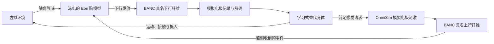

# Remain Brain Consciousness

**用虚拟果蝇检验身体替换后的感觉运动功能。**

如果让原身体退出控制回路，脑能否通过双向神经接口驱动一个学习式替代身体，并收到它在环境中产生的感觉？这是本项目目前要检验的问题。我们选择果蝇，是因为公开的脑和腹神经索连接组提供了可追溯的神经路径，现有模型也能在计算机上进行重复实验。

研究的长期动机是理解身体替换后的功能连续性，以及这能为意识连续性的研究提供什么证据。当前结果来自短时仿真，验证范围是信号传递和部分感觉运动行为。生物脑的长期维持与意识连续性仍是独立的研究问题。[研究路线图](GOAL_ROADMAP.zh-CN.md)

## 实验怎么工作

原物理身体使用 **FlyBody / MuJoCo**，产生行走、足端接触与进食示范。我们从同一回合的模拟相机图像、测力地板和电极电压中重建姿态、分配逐足载荷并解码下行脉冲，训练替代身体预测下一时刻的姿态和足压。接触后收步是一个单独模块，在检测到持续口器接触后启用，训练时冻结原接近动作和足压模型。

替代身体在虚拟场地中运行时，冻结的 **Eon** 脑模型继续产生神经活动。模拟电极读取下行，替代身体产生的前足感觉经 **OmniSim** 计算电刺激和轴突传播，只有模拟中到达脑侧的登记事件才送入脑模型。触角气味走独立的头侧输入。

颈部接口登记了 **52 条**可追溯至 BANC v888 的路径，包括 27 条下行、25 条上行。替代身体觅食试验使用其中 **17 路下行读出和两路前足上行反馈**。轴突身份与路径有解剖来源，传导、膜动力学和电极响应按工程模型计算。[颈部接口约束](NECK_REAL_STRUCTURE_REQUIREMENTS.zh-CN.md) · [颈部与嗅觉联合实验](experiments/open-brain/20261119T202650Z-neck-odor-integration/REPORT.zh-CN.md)

## 目前验证到了哪一步

在四个 6.4 秒的平地模拟电极闭环场景中，我们比较了三个替代身体版本：

| 替代身体 | 摄入达标 | 摄入并在末段站稳 |
| --- | ---: | ---: |
| 原长递推模型 | 3/4 | 0/4 |
| 接触后按姿态和足压收步 | 4/4 | 4/4 |
| **接触后收步并保留下行响应** | **4/4** | **3/4** |

在固定下行回放中，两种收步模型各保留了 **22/22** 条口器接触。关闭场景 `88207` 的模拟刺激电流后，两条前足信号的脑侧到达和该回合摄入均降为零。保留下行响应的版本是当前研究候选，只按姿态和足压收步的版本用于站稳对照。四个场景中只有一个新食位，候选在该场景仍未通过末段速度门。站稳由运动学与估计足压判定。[实验报告](experiments/open-brain/20261121T060600Z-postcontact-settling/REPORT.zh-CN.md) · [逐场景验收](experiments/open-brain/20261121T060600Z-postcontact-settling/acceptance.json)

**下一项验证**是在同一个持续运行的仿真脑实例中，于任务中途切换身体，保留膜状态和在途事件队列，再比较切换前后的信号、行为中断和恢复。现有结果衡量的是短时任务表现。跨切换点及长期功能连续性尚待测试。[实验计划](GOAL_ROADMAP.zh-CN.md)

## 研究目录

| 研究线 | 内容与入口 |
| --- | --- |
| **P1 · 开源脑与替代身体** | Eon 接口、具名颈部通路、模拟电极、导航与物理教师、学习式替代身体。[实验目录](experiments/open-brain/) |
| **P2 · 独立人工脑** | 训练另一套感知、意图和行为模型，经有解剖来源的颈部结构接入身体。[设计](RECOVERY_DESIGN.zh-CN.md) · [实验目录](experiments/neck-real-structure/) |
| **独立 BANC—肌肉身体** | 周边感觉、腹神经索、运动神经元至肌肉的接口与六足承重。[项目说明](experiments/banc-muscle/README.zh-CN.md) |

[共享身体与感觉代码](engine/embodied/) · [专用身体与肌肉资产审计](BODY_MUSCLE_REVIEW.zh-CN.md) · [限定行走基线](WALKING_CURRENT_STATE.json) · [完整研究记录](GOAL_TRACKER.zh-CN.md)

## 查看证据和复跑

可以直接阅读实验的 `REPORT.zh-CN.md`、协议和验收 JSON。要复跑某一实验，从该报告里核对 Python、仿真器、数据和权重版本，再使用对应入口：

- [接触后收步闭环](experiments/open-brain/20261121T060600Z-postcontact-settling/run.sh)及[实验协议](experiments/open-brain/20261121T060600Z-postcontact-settling/protocol.txt)
- [颈部损伤与绕墙觅食复跑说明](experiments/open-brain/20261119T202650Z-neck-odor-integration/REPRODUCE.zh-CN.md)
- [身体依赖](requirements-body.txt)与[内感觉检查脚本](verify_fly_interoception.py)

仓库收录代码、协议、报告和小型验收汇总。大型权重、原始轨迹及外部模型资产需要对应归档。部分运行入口仍依赖原归档路径，克隆仓库后需要补齐这些资源。

[项目许可证](LICENSE)
