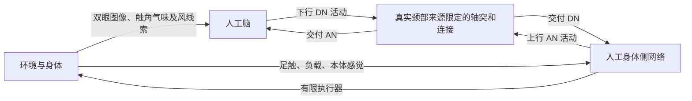

# 项目重建审计与三部分设计（2026-11-15）

本文件用于**人工搭建大脑项目**。开源果蝇脑模型的重训练或翻译层是独立项目，采用其自己的模型身份、训练记录与验收。下文的详细方案将人工身体侧网络作为独立训练对象，并明确三纤维试验的范围。

## 决定

建立新的、可审计的 **其他 ⇄ 真实来源颈部结构 ⇄ 人工脑** 实施线。现有仓库、权重和实验目录保持原样作为证据库；新实施从固定的行走归档标签建立隔离工作树，之后只逐项引入通过审阅的较新源码和适配器。不要把大量未跟踪实验目录整体复制进新运行主线，也不要把旧实验的 PASS 自动继承为新架构的 PASS。

这里的“污染”首先按**来源和结论未完成独立核验**处理，不预断文件被恶意篡改。是否可复用由内容哈希、源码审阅、独立重放和实际身体验收决定。

## 本轮实际核查

| 对象 | 核查结果 | 可用范围 |
|---|---|---|
| Git 基线 | 当前 HEAD `d5c8ce8fb08e52bdf677dfc2e9b8631a6f949e21`；行走标签 `walking-verified-20261110` 指向 `7e41fa626fc8e0857b5323f47d0b8f0a90f6a0f7`。工作树有 3 个已跟踪文档的本地修改，颈部、视觉、运动增强等大量目录未跟踪。 | 从固定标签建立隔离实施线；HEAD 后续内容和本地修改均须逐项审阅后迁入，不清理原件。 |
| 旧行走权重 | `checkpoint_002500.pt` 实际 SHA256 为 `246f9fab7d21e2a1332a745fafd4a343b80ad5a70d2cafeeb900e876f7933809`，与 `WALKING_CURRENT_STATE.json` 一致；归档验收声明限定派生身体、有限 PD、替代 ANN 行走。 | 可作为身体侧基线和训练参考；不是新脑颈身体架构验收。 |
| 已实现颈部 | `SOURCE_BINDING.json` 登记 BANC v888 的 DNp09 两根、AN08B018 一根及来源文件；`source_transport.py` 是 1 ms 计时、2 ms 延迟、增益 1 的身份队列。`body_pilot/runtime.py` 把人工脑的 DN2 经队列送到转向解码器，底层步态由另一已训练 ANN 产生。 | 有来源的**三纤维限定接口演示**；队列不是膜动力学、颈部局部连接网络、实测电极或全颈部。上行 AN 的原生感觉调谐未建立。 |
| 三部分限定实验 | `FINAL_SCOPED_ACCEPTANCE.json` 记录 6 个完整身体回合、空指令五工程门通过；同一报告明确转弯滑移失败、脑控制启动/停步未通过、生物颈部完整模型和电极映射均未通过。 | 作为可复核的限定工程结果，不扩大结论。 |
| 最新 900 运动权重 | `checkpoint_000900.pt` 实际 SHA256 为 `e9829e4b94f235889b44d495397d16fb072c9d43f8d2d9cffe91569d46956500`。`FUNCTIONAL_MOTION_REPORT.json`：行走次级功能门通过，但原滑移 6.491 > 0.5；停步和左右转均失败，原四任务全未通过。`state_aligned_motor_body/SUMMARY.json` 明确 `new_neck_deployed=false`。 | 诊断候选，不能替换旧通过权重，不能称已完成三部分运动闭环。 |
| 状态记录 | `NECK_CURRENT_STATE.json`、增强目录 `CURRENT_STATE.json` 与 `GOAL_TRACKER.zh-CN.md` 包含大量历史运行时状态和阶段性文字；最终记录仍显示全脑颈身体部署未验证。 | 只作为索引。每项结论须回到原始模型、输入、代码、结果和失败记录。 |

本轮做了文件读取、两份权重 SHA256 实算和源码静态检查；**没有重新训练、重放或物理仿真**。这份审计不能独立认证所有历史数值和视频。

## 可行性判断

| 目标 | 判断 | 必需证据 |
|---|---|---|
| 保留原行走工程基线 | 已有可核对证据，限定成立 | 固定权重、身体 XML、输入与独立物理重放。 |
| 构建可追溯的颈部解剖清单 | 可实施，但目前只核验了运行用三根 | 同一 BANC 版本的神经元 ID、形态、颈部截面、方向、连接边与缺失记录。公开 BANC 数据集和颈部比较研究可作来源，不能跨样本直接拼 ID。 |
| 人工脑经指定颈部端口调制身体 | 已有小范围工程演示 | 端口因果切断、时序、持续完整身体回合；必须区分底层身体 ANN 的自主贡献。 |
| 由连接组直接得到真实颈部电活动或电极效果 | 当前不可验收 | 连接与形态不能自动给出传导、突触符号、膜参数、电极混合和伪迹；这些需另外测量或标成工程假设。 |
| 新三部分模型自主行走、可靠停步及转弯 | 尚未建立 | 同一冻结版本的独立完整物理测试、原门槛与消融对照；900 组件结果不能代替。 |
| 由仿真证明意识连续性 | 当前实验设计无法判定 | 运动、神经活动或接口成功都不构成意识验证；另需独立研究问题和测量方案。 |

数据参考：[BANC 发表版数据集](https://doi.org/10.7910/DVN/7WTH1N)、[果蝇颈部上行和下行神经元比较连接组研究](https://doi.org/10.1038/s41586-025-08925-z)。本设计只借这些来源界定可核查的结构；具体运行单元仍须对原数据逐 ID 审核。

## 新实施的边界

```text
环境 / 完整身体 / 身体侧感觉编码与执行器（其他）
             ⇅ 只接收声明的 AN/DN 端口活动
带数据版本、原始 ID、方向、形态及可证连接的颈部结构
             ⇅ 只接收声明的 AN/DN 端口活动
人工训练脑（状态、任务输入、脑侧真实直达感觉另列来源）
```

1. **来源层**：每根纤维有版本、原始 ID、方向、真实颈部穿越证据；连接边要附原始边表/突触证据。纤维身份、内部突触、递质、动力学是不同字段。数据缺失保留 `UNKNOWN`。首版允许三纤维限定演示，但不得称“完整真实颈部”。
2. **运行层**：颈部程序只实现有来源的结构和单独标注的工程传播假设。神经动力学未标定时，明确写为“身份约束的传输模型”。若以后加入真实连接子图，边只从可追溯数据导入；学习参数不能改变结构身份，也不能凭训练结果填补未知连接。
3. **脑层**：当前人工脑可训练，但部署输入只能来自已声明的脑侧感觉和交付的 AN 端口，输出只能是 DN 活动。实验任务指令是人工输入，须在结果中单列；不能因此声称视觉识别或脑自发决策。
4. **其他层**：完整身体、有限 PD、传感器和底层运动 ANN 均明示工程身份。脑的输出不直接写关节；DN 到运动控制的可训练映射是身体侧适配器，不是解剖学突触。脑控制启动、停步和转弯应与底层保持行走的能力分别测量。
5. **电极层**：当前不接真实动物。未来记录/刺激模型与上述仿真信号分轨，样本、覆盖、时延、混合与伪迹未知时不得写“电极已验证”。

## 迁移顺序与验收门

**阶段 0：可信基线。** 新隔离工作树从 `walking-verified-20261110` 建立；把当前工作树做只读清单与哈希快照。先独立重放旧行走的核心物理指标，并记录代码、权重、环境及原门槛。失败则只报告失败，不修改旧报告。较新已入库源码也须逐项审阅，不能因其已提交便自动迁入。

**阶段 1：来源和接口。** 逐 ID 重审首批三纤维的 BANC 版本、形态、穿越、方向与可证连接。实现小而稳定的 `SourceNeuron`、`NeckPort`、`BrainOutput`、`BodyFeedback` 数据契约。生产运行拒绝无来源 ID、未来信息、未声明旁路、伪造内部连接和单位/时间漂移。至少做 DN/AN 切断、恢复、时延与独立重放。此门只叫“来源限定接口通过”。

**阶段 2：同一三部分完整身体。** 冻结身体与旧行走基线，脑只经 DN/AN 端口接入；预注册空指令、启动、停步、左转、右转及各通路切断。记录教师撤除后的同次身体状态、接触、真实位移和神经消息。分别报告旧行走门、运动任务门、颈部因果门，不用次级功能口径覆盖原失败。

**阶段 3：扩大结构与生物对照。** 只有在连接边和感觉/运动映射可追溯后扩大端口；采用独立的生理数据校准动力学。没有数据时停在已验证的结构范围，不用人工颈部 ANN 补齐却仍称真实符合性。

每阶段的发布产物只保留：声明、源清单、可运行源码、固定输入、权重哈希、原始结果、独立审核和一页结论。失败与未知单列。实验脚本与大轨迹放在按时间戳的证据目录，**不再让历史 tracker 或目录名决定模型状态**。

## 下一最小实施动作

先做阶段 0 的**只读快照与独立基线重放**，随后建新的三部分契约和一条可运行的三纤维最小闭环。当前不再续训 900 运动候选；它尚未解决停步/转向，也未部署颈部。旧颈部代码可作为参考实现逐项迁入，不能整体视为可信主线。

## 人工脑与身体侧网络的训练方案

### 模型边界

“人工腹部”在此扩为**人工身体侧神经系统**，包括胸部运动控制和腹部内部状态调节。六足执行端放在胸部对应的腹神经索（VNC）侧。身体保留头、胸、腹、六腿和自由根。人工脑负责选择行走、转向、探索、停步、取食等行为，并通过已登记的 DN 活动改变身体侧策略。身体侧网络使用足触、关节位置和速度、负载等局部反馈协调六足，经 AN 回传与来源相符的感觉或身体状态。头部双眼和触角输入经各自的脑侧感觉编码进入人工脑。



颈部使用同一 BANC 版本的原始 ID、左右侧、轴突穿越证据，以及可核验的脑侧和 VNC 侧伙伴与突触证据。颈部截面两端属于同一轴突的记录按身份接续。突触留在原数据支持的位置。人工脑和身体侧适配器的权重可以训练。真实颈部拓扑固定，延迟、噪声和动力学按实测、文献先验、工程假设或未知分别登记，部署留存采样、到达和消费时间。DNa02、DNg13 等从转向研究提出的候选应先逐个核对 BANC 身份、投射和同类映射。启动、制动与负载反馈同样依来源选通路。旧 DNp09 和 AN08B018 先用于身份、时序和切断测试。旧 AN08B018 的感觉输入主要与振动有关，不能据此给整组关节姿态、足载和滑移赋予该纤维的生理身份。

### 训练顺序

1. **先验收完整身体与执行端。** 重放通过的平地基线，核查不同接触面的法向、切向和足地相对滑速。再独立测低坡、单凸台和混合粗地形。用相同控制网络配对改变障碍材质/外观与几何，分别测视觉和接触影响。平地参考、粗地形通过率与实际身体跨越分别计算。遇到棱边挂靠需求时单独核验爪钩接触与脱离，足垫黏附作为另一个物理机制。
2. **训练人工身体侧运动网络。** 用一个带记忆的策略，汇集六腿局部观测并联合输出现有 42 维关节增量。先让有真实运动数据约束的、通过物理门槛的教师提供前进、站稳、起停、左右转及错步恢复示范。在独立训练台给身体侧策略可独立变化的推进和转向目标，收集模型自己走出的偏离状态，再由合格教师在同一状态给动作标签。以短窗口物理闭环及新地形表现决定是否扩训。模仿后可用受约束的 PPO 微调推进、转向、支撑、滑移与执行器开销，长训练前核对实际损失、GAE、优化器和保存重放。该训练台的运动目标在三部分部署时由已交付的 DN 活动解码产生。
3. **做颈部通路容量对照。** 身体训练台先验证推进、停步、左右转能从同一组起点重复执行。保持身体、任务、扰动与评估一致，再比较三纤维范围和经过来源核验的扩展端口。测试下行命令是否可区分，足滑、受阻或失去支撑后，人工脑能否利用已交付的上行信号改变策略。若多个任务在部署观测下长期不可区分，先定位传感器、通路覆盖或延迟的缺口。若身体训练台也失败，优先诊断动作策略和物理接触。若要判断真实通路结构是否贡献了行为，用相同通道数、延迟和训练预算的配对对照，避免将增加带宽造成的改善归给解剖拓扑。
4. **再训练人工脑和三种感觉。** 先冻结身体策略和颈部结构，用独立的速度与偏航响应训练脑侧行为，再把实验任务输入替换成实际感官流。视觉由真正随头部姿态变化的眼图驱动，测试光流、障碍接近、遮挡与外观变化。嗅觉使用触角位置采样的时变气味和风线索，从单侧脉冲到间歇气味羽流。触觉分为足地接触/负载、本体感觉和可取得的振动量。触碰扰动先检验 VNC 的落足恢复，再检验经 AN 影响脑的行为选择。联合训练用同向、冲突、缺失线索与留出世界。目标坐标、几何真值与未来数据可用于教师或评估，部署只接收声明的传感流和颈部消息。必要时再小幅联合微调两端，并用此前通过项目复验。
5. **最后实现模拟生存。** 首版做能量与水分两个可查账的内部状态，支持活动消耗、实际取食饮水带来的补充以及静息代价。食物接近、停驻、口器接触和摄入分别记录，只有事件确认摄入才增加储备。脑可读取按路径登记的内部感受代理。用饥饿与饱腹对照、无资源、不营养食物、资源搬移、阻断摄入等条件，验收是否学到寻找、选择与恢复。以预登记时长内的储备范围、有效摄入和独立环境表现定义模拟生存。模型中的代谢变量属于工程近似。

### 验收和术前用途

- 平地保留原步行门。坡面、转弯、静止另用支撑、安全、轨迹、速度、朝向、横漂、绝对足地滑速及真正越障等适用指标。近静止时，相对净推进的滑移比分母过小，须保留原指标的适用范围。
- 用成对初态和留出世界做 DN 特定组切断、AN 特定组切断、同时切断、延迟/衰减和从同一状态恢复，记录动作、身体姿态、感觉、颈部消息和行为全过程。配对条件应在干预前一致。DN 切断后局部支撑或步态可能持续，检验的是脑对身体的调节能否消失。AN 的贡献用需要身体反馈才能完成的任务检验。
- 术前先冻结同一平台的接口、权重、身体、感觉和评估口径。使用虚拟干预建立基线和对照。活体阶段另做样本对应、可观测性和电极记录/刺激校准，比较群体混合、时延和实际反应；仿真结果提供待检验的预测。

### 本轮查看的实验与优先级

- 900 版的 300 行实际训练日志从更新 601 到 900，保存轨迹动作误差项由约 0.001428 降到 0.000914。物理结果的原步行滑移仍为 6.491，停步及左右转均失稳。应优先增加实际闭环偏离状态的覆盖，而非用同一批记录继续压低误差。具体根因待试验。
- 匹配平地保存结果自主约 38.4 秒，最大滑移比约 0.485。粗地形未通过。灰色凸台对照中眼图和转向输出确有变化，滑移比未改善。复杂地形可做，但当前身体与策略需分开诊断。
- 既有三部分平台记录了真实渲染图像驱动的有限远红地标定向，但 AN 反馈必要性尚未建立。嗅觉留出试验正常 8/8 到达，延迟切断 5/8，预登记因果差值未通过。后续多感官试验保留右后腿周期和嗅觉撤除失败，尚未验收取食与生存。
- 当前第一项实施建议是**平地闭环起步、停步与左右转及原行走回归**。先用身体训练台找出可控的物理基线，再用来源限定颈部复测同一组任务。若三纤维只支持部分工作范围，按连接证据扩充通路并保留原版本作为对照。

参考来源包括 [BANC 发表版研究](https://doi.org/10.1038/s41586-026-10735-w)、[果蝇下行转向研究](https://pmc.ncbi.nlm.nih.gov/articles/PMC12778575/)、[果蝇腿感觉连接研究](https://pmc.ncbi.nlm.nih.gov/articles/PMC11071415/)、[NeuroMechFly v2](https://doi.org/10.1038/s41592-024-02497-y)、[数据驱动的果蝇全身物理模拟](https://doi.org/10.1038/s41586-025-09029-4)与[间歇气味羽流行为实验](https://doi.org/10.7554/eLife.57524)。本轮对旧源码、日志和产物做了只读核对。

## 智能模型、学习信号和颈部梯度

身体和四肢由另一个 agent 修复。本方案以版本化的身体接口接收局部观测和应用有界动作，用交付的身体做集成验收。底层人工 VNC 是一个快速循环策略，用各腿的局部编码和跨腿协调状态将当前身体反馈和已交付的 DN 活动变为关节动作。人工脑采用感觉编码器加慢一层的循环策略，结合图像、气味与风、已交付 AN 及声明的内部感觉，产生各登记 DN 的有界活动分布。速度和偏航是训练与测量目标。部署的跨边界信号始终为对应轴突活动。

### 分阶段学习

1. **运动能力预训练。** 在身体训练台用通过闭环验收的教师提供动作。策略先学站稳、起停、转向、失去支撑后的换步，再由教师给模型实际走到且教师能够纠正的状态标注。身体训练台可接受明确的训练任务目标。接入三部分闭环时，身体只能使用本地反馈与实际交付的 DN 活动。已有运动权重可经兼容性回归后作初始化。
2. **标定跨颈信号。** 冻结结构，先在仿真中用受控 DN 活动测量交付值和实际身体响应，区分启动、推进、制动和转向可达范围。用相同初态和安全的活动范围，以出现的行为响应为依据，给脑侧行为教师提供可执行的 DN 示范。教师只能提供行为目标时，以响应拟合和强化学习学习 DN 输出。AN 编码优先用对应受体/通路的观测或文献约束做独立校准，标出功能未知项。三条纤维用于对照，任务容量由留出响应测定。
3. **训练脑的行为选择。** 用短程任务教师和模仿初始化脑侧策略。冻结身体侧网络，采用循环 PPO 在实际颈部闭环中训练。脑侧先学有明确结果的起停和定向，再学依视觉、嗅觉、触觉反馈选择行为。长期任务逐级拉长，以真实越障、摄入和储备恢复作为结果。局部运动保持的价值和长程任务的价值分开估计，防止持续行走掩盖不会停步或找不到资源。
4. **需要时交替微调。** 固定脑侧更新身体侧运动策略，或固定身体侧更新脑。每轮按当前权重重新采样，保留独立参数和优化器。对上行保持来源与活动约束，以局部有依据的监督为首选。部署感官流只通过登记的路径到达相应策略。训练时 critic 可以读取当下的完整模拟状态和在途消息，critic 的观测与状态不传给策略或跨边界。

### 梯度如何处理

- 已有软件颈部是固定路由和整数延迟的队列。若用张量写成 `y[i,t] = g[i] * x[i,t-d[i]]`，迟到的那一项仍有导数 `g[i]`。窗口必须覆盖延迟，并保留消息在回合和循环状态的真实归属。真实接口若被切断或部署源码用 Python/NumPy 队列切掉计算图，自动微分走不到发端。阈值脉冲、丢包与接触碰撞也会使整条路径不适合靠普通反传。
- 主训练用策略梯度。脑策略采样发送端的有界 DN 活动并记录其对数概率。固定颈部、身体策略和物理引擎执行真正的前向闭环。用行为结果算这一决策的优势，再对发送端的策略概率求导。梯度形式为 `A_t * grad(log pi(DN_t | brain_history_t))`，PPO 用概率比约束更新。它适用于不可微的模拟转移。若 DN 活动随后转换成脉冲或部分丢失，记录发送动作及其概率，同时记录实际交付值，仍按发送动作归因。身体侧策略学习时，对它采样并应用的关节动作做同样的更新。
- 每个决策窗记录发送、交付、消费、动作和回报。估计优势时按实际时间累积后续回报，并正确处理回合截断后继状态的价值。循环策略按连续序列重建记忆。将资格预检集中在实际 PPO 损失、动作概率、优势与优化器更新。
- 若以后有经过校准的脉冲模型，可另评估替代梯度作辅助预训练，只在反向使用近似导数，并用同一冻结颈部的前向闭环复验。若某条通路在送固定不同活动时实际交付或身体响应始终不可区分，先排查结构覆盖、量化、饱和、计时以及观测可用性。通过扩充经来源核验的通路或缩小任务范围解决可控性与可观测性。

第一次集成测试从同一组初态开始，比较正常 DN、匹配活动范围但时间打乱的 DN、切断 DN，以及触碰扰动下的正常 AN 与切断 AN。检查低层站稳、脑能否使步态启动与停止、左右转向差异，以及上行是否提供超出脑侧感官历史的可用信息。较长 PPO 训练以这些诊断为输入。

方法来源：[PPO](https://arxiv.org/abs/1707.06347)、[GAE](https://arxiv.org/abs/1506.02438)、[DAgger](https://proceedings.mlr.press/v15/ross11a.html)、[脉冲网络替代梯度](https://arxiv.org/abs/1901.09948)。

## 身体侧上行学习与离体研究接口

身体侧学习包括局部动作策略和上行感觉编码器。动作策略用已交付的下行活动和局部感觉决定关节动作。上行编码器用可追溯的感受器输入与局部状态，产生对应 AN 的活动。另登记直接上行的感觉神经元以及脑侧感觉路径，实际参照来源决定它们在模型里的位置。

1. **动作策略**用教师示范和局部闭环指标学习支撑、调整落脚和恢复。训练时先固定脑与上行编码，评价动作后的足载、滑移、支撑和任务响应。采用 PPO 时，以实际采样的关节动作概率更新身体策略。
2. **上行编码器**先在受控触碰、振动、关节运动和负载试验中校准。若有同一通路的生理记录，监督活动强度、时序与调谐。只有结构证据时，在固定通路上做工程编码试验，用颈部交付后的脑侧读出测试是否仍可区分来源支持的刺激特征。预测标签取自受控刺激、传感器或物理测量。旧 AN08B018 可用于检验振动相关传输的工程假设，其他感觉和内感受需各自查证。编码器的活动范围、采样率和带宽作为明确、可复验的约束。
3. **上下游闭环**先冻结上行编码器，训练脑根据它做出可辨别的选择。若闭环结果仍需调整身体侧编码，可固定脑与运动策略，让编码器在校准约束下采样 AN 活动并记下发送概率，以延后的行为结果做策略梯度更新。通道身份、输入来源、校准损失与留出读出仍作约束，防止两端发明只有模拟网络才能认出的隐含代码。
4. **内感受**先登记具体来源。经颈部传到脑的神经信号使用审定纤维。脑直接感受到的体液或其他来源保留对应的机制和不确定性。果蝇脑内有对渗透压与代谢激素敏感的细胞，模拟能量和水分账本属于环境真值，训练可用作标签。部署输入采用来源明确的感觉代理。

首个行为因果试验可从相同初态随机给左或右侧机械扰动，在脑形成第一个选择前匹配或遮蔽头部线索，配对比较正常 AN、选择性切断、时序或左右错配的反馈，以及通过相同来源通路重新注入匹配反馈。评估上行交付、脑的 DN 选择与身体结果，分辨局部反射和脑用反馈后的改道。保留原假设与失败，不用总奖励替代这些读出。

术前平台需要给出各功能所依赖的信号、方向、时序、切断后残余功能，以及哪些反馈在仿真里可恢复闭环。电极阶段另核查实际记录得到哪些群体信息、实际刺激能否可区分地驱动所需感觉通路，以及两者的带宽、混合、伪迹、时延和不确定性。独立评估神经组织可用性和代谢条件。当前模型支持感觉运动与内稳态功能的因果预测，意识维持仍是独立问题。

来源：[腿本体感觉与外界振动的不同通路](https://doi.org/10.1038/s41467-025-59302-3)、[果蝇脑内渗透压与代谢信号感受](https://pmc.ncbi.nlm.nih.gov/articles/PMC4983267/)。

## 身体侧第一版设计与内感受审计

本阶段设计人工果蝇的身体侧运行模型。物理底座使用已验收的完整 42 路有限执行器身体。粗糙面足爪派生件用于配对验证。肌肉模型和运动池保留为独立执行端，待动态力矩和带接触的行为验收后，可通过同一身体接口另接。现有足爪结果支持台架挂靠、短窗平地回归和固定姿态接触注册，粗地形整蝇越障仍待测。

### 内感受首版审计

| 部分 | 证据与集成决定 |
|---|---|
| 六腿本体感觉 | 独立复跑原验证通过，读完 15,400 条归档记录，其中自主期 9,600 条。额外编译并核对粗糙面足爪派生体，六条股胫铰链的 qpos/qvel 地址、关节范围和屈曲方向均与平地版匹配。24 路可作为身体局部工程观测。四路中屈伸位置互补、运动方向互斥，信息源实际是关节位置和速度。自主期各腿角速度峰值为 0.49–1.79 rad/s，工程标度 10 rad/s 下没有饱和，训练前需按受扰数据检查信号动态范围。 |
| 状态身份 | `MujocoTibiaSensors.read` 只检查向量长度。两份同维但逆序的 MuJoCo 探针模型可互相误读，真实示例中左前腿从 1.667 rad 被读成 0。在线适配器创建时绑定同一编译模型及其数据。离线轨迹读取验证源模型与具名关节布局签名，拒绝身份不明的轨迹。 |
| 咽部与消化道 | 四段体积账本在 10 ms 台架上复跑，守恒残差 4.77e-14。用 5、10、20 ms 对照时，空腔首次后肠到达相应为 20、40、80 ms。这是按步推进的设计行为，当前只能用固定器官时钟作工程台架。若任务涉及饱足反应时延，使用以秒定标的转运模型并核对物料守恒与步长收敛。咽部可进独立头部局部接口。嗉囊、前肠牵张已有研究线索，具体路由、神经身份与幅值仍待绑定。 |
| 心脏与内稳态 | 心壁输出是外部提供的直径和变化率的诊断代理，没有内部心脏动力学。肠段含量衡量充盈程度。吸收、能量和水分需要另立状态与物料收支，对饱足和饥饿的代理另做映射。 |

生理依据包括 [腿部本体感觉与外界振动](https://doi.org/10.1038/s41467-025-59302-3)、[咽泵局部机械感觉](https://pmc.ncbi.nlm.nih.gov/articles/PMC11616994/)和[嗉囊及前肠的 Piezo 牵张反馈](https://pmc.ncbi.nlm.nih.gov/articles/PMC7920550/)。本轮复跑使用归档 Python、MuJoCo 3.9 和已有 FlyGym 加载器，验证脚本与附加探针均退出 0，无新整蝇物理积分或训练。

### 运行接口与执行顺序

1. **物理步与观测。** 身体适配器绑定模型、执行器和具名传感器布局。每个控制步从上一段完成的积分取得时间戳、腿序、股胫本体感觉、逐足接触及关节观测。逐足接触统一归属三球或足爪，记录当前足相对接触面的法向承载与切向速度，保留足端和非足接触区分。感知值附有效位和采样时刻，真实的零与缺失分开编码。诊断侧保留原始角度、饱和、模型身份和接触来源。世界真值用于记录与教师。
2. **快时标 VNC。** 六腿共享局部观测编码，保留腿位与左右身份。循环协调层汇集六腿状态和已交付的 DN 活动，输出有界的 42 维增量，由已验收的有限执行器施加。用原步行决策周期作起点，足载窗口与上一控制步的物理结果对齐。教师预训练后用受扰轨迹和实际后果学习支撑、落足、停步与转向。第一版比较原始关节量与 24 路股胫代理，检验编码形式是否改善学习或闭环鲁棒性。只有通过单侧扰动且出现脑侧可验证响应后，才对相应上行任务作结论。
3. **慢时标器官。** 首版单独运行固定 10 ms 工程消化时钟。显式摄取事件和有界吞咽决定入料与转移。食物体积、营养和水分各有账本，确认吸收后才补充储备，活动消耗使用声明的工程模型。先对空腹、只装载而不吞咽、摄入无营养体积和实际吸收做对照。咽部读出进入头部约定接口，心壁及未绑定器官读数进入诊断记录。器官读数从前一已完成的器官步采样。
4. **跨颈路由。** 身体侧先运行局部观测与动作。上行接口逐个批准传感来源、原始纤维、方向、传输时序和有效范围。具名供体绑定后才把可验证的身体事件编码发往 AN。脑侧只消费经过相应路由实际交付的活动。嗉囊和肠道信号先核对是否经颈部、外周神经或体液到达脑，再采用有依据的路径。

第一次集成先实现具名观测帧和模型身份保护，用保存轨迹校核两份身体的六腿读数和有效位。随后在平地基准上比较无扰动与随机单足扰动，同时记录足触、负载、关节感觉及局部策略动作。待该回合能可靠重复，再迁入粗糙面并做来源明确的 AN 对照。器官台架可独立检验数值接口，摄食、长期内稳态与离体干预安排在运动主线和相应感觉通路验收之后。

### 运动侧策略与第一批实验

运动侧采用一个循环策略协调六条腿。每条腿共享编码器并保留腿位身份。跨腿协调的循环状态汇集逐腿观测、胸部可用的局部运动线索、已交付的 DN 活动，再由逐腿输出头生成七个关节目标的变化率。当前采用原 5 ms 决策和 1 ms 目标积分时钟，沿用执行器的 2 rad/s 限速、目标限位和有限力矩。网络从当前反馈和自己的记忆学会支撑及摆动。停止口令期间仍连续计算动作，用实际承重、质心稳定和低漂移验证它能站稳。

训练台中的推进和偏航目标独立变化，覆盖直走、向左或向右弧走、低漂移的左右原地转和从走到站。旧桥接把推进写成 `relu(turn)/3`，只能作为旧接口对照。正式运行中的推进与转向由经过真实颈部交付的下行活动及身体侧解码产生。若现有 DN 子集在同一初态只表现出绑定的速度和偏航变化，则逐条查证与扩充来源明确的通路。

1. 先用旧通过模型在同身体复现前进。站立、制动和转向示范各自经过物理验证，随后混合得到一种循环策略。采集同一回合内的站立→走→停→再起步，及两向转向，保持身体、神经和目标状态连续。
2. 用训练模型自己的实测轨迹找出将要摔倒、落脚不稳及停步漂移的状态。教师仅在能够实际纠正的同一状态补动作标签。随后用少量实物理滚动的循环 PPO 微调。直走奖励持续推进，站立和转向分别优化低漂移和目标方向。各任务均单列非足触地、异常滑移、执行器饱和及支撑指标。
3. 在自主窗口内插入有记录的单足冲击或局部低摩擦区，成对测恢复时间、推进和足部滑速。依次扩展到坡面、单障碍和留出复杂地形。跨任务使用同一权重，并对同一初态比较正常 DN、显式停步、下行切断，验证脑的调节及身体剩余能力。

第一项实验用固定平地身体跑完整的站立→走→停→再走和左右转条件。腿和肌肉修复交付后，经同一观测接口测试新的力学派生件。肌肉版另核验动作指令的可实现力矩和激活范围，并独立验收从同样任务得到的真实物理运动。

### 用户收窄后的运动课程

当前先训练一项任务，即稳定站立与受扰恢复。快时标身体侧先用无循环状态的网络，输入为当前关节状态、足载、躯干运动及执行器的当前目标。行为历史和路线记忆放在脑侧。关节速度和有限执行器的当前目标是已有物理与执行状态。

训练先采集真实身体在不同方向、多腿扰动后的可行教师恢复。评估使用留出的扰动，当前网络与相同有限执行器的零动作对照从完全相同状态开始。关节目标被扰后的纠正、实际身体姿态和载荷恢复分别报告，机械推力条件下单独测量身体和执行器自身的恢复。通过第一项任务后才考虑下一单项动作，之前的多任务循环模型保留为失败对照。

在线受扰复验使策略在扰动前取得首帧观测，受力期间和撤力后连续控制。站立安全与恢复时间各有明确窗口。最大与末端位移记录为诊断量，原 0.1 体长峰值门保留为历史参照。若未来任务要求回到原点，另建立位置任务和对应观测。纯机械推力需要比较同剂量下的安全、稳定和恢复时间，执行器目标偏移纠正另列。

## 抗扰纠正示范扩充实证

站立策略的采集单位是独立物理扰动轨迹。教师每 5 ms 据躯干运动和各足载荷生成有限目标速率，先通过同态受力对照，再作为动作监督。先从教师闭环采集，后从第一版网络实际访问的状态由教师接续补采。纳入 31 条新轨迹与 10 条既有轨迹，共 10,059 个动作对，详见 `experiments/body-motor-learning/20261115T190620Z/REPORT.zh-CN.md`。

执行器会积分目标速率，首版无约束残差的撤力后小动作累积成显著目标漂移。第二版按当前目标回正，用当前躯干线速度和角速度决定学习修正幅度。身体网络没有循环隐状态。独立纯推力留出中，加入学习修正后通过数为 9/12，与同结构仅回正对照一致，平均恢复时间 281.8→234.6 ms。结论范围为这套平地台架和这一批短窗扰动，详见 `experiments/body-motor-learning/20261115T191709Z/REPORT.zh-CN.md`。

## 多初态、足端接触和跌倒后翻正

1. 基于实测物理轨迹建立初态库。在同一身体正常站立、自然重心偏移、左右承重不均、轻扰后带角速度的状态保存完整积分态、执行器目标及观测所需物理量。同一初态各比较臂完全配对。来自同一连续母轨迹的所有快照分在同一集合，按母轨迹和扰动配置整组留出。保留标称快照作为回归，用交叉控制的方向、持续时间、施力位置和力幅检验策略泛化。记录不同初态的表现分布，旧的单快照结果作为限定基准。
2. 在站立台架增加足端接触及原生接触事件的记录，至少有接触体段、三维法切向载荷、支撑腿、躯干倾角、开始时间和持续时间。约 0.5 倍体重下短暂踉跄后恢复可接受。约 0.8 倍体重下跌倒可接受，单列是否有伤害代理量和之后能否重新站稳。这两个幅度是工程测试剂量，应和持续时间、归一化冲量与偏心力矩同时记账。旧零非足接触定义和结果作为历史证据保存。
3. 足端力学对接已有双爪几何样件。粗面上预先核对足爪确实与凸棱承载，比较有爪有凸棱、有爪平地和去爪有凸棱，记录抓住和卸载脱离。光滑面上的足垫黏附按独立接触模型和法向、剪切、剥离对照校准，未定参数保留未知。在新整蝇的可比平衡初态上先冻结旧控制做力学配对，再用通过校验的接触数据训练。这样能量化新足端本身和策略学习各自的作用。
4. 自我翻正另立身体恢复动作。从静止侧卧与仰卧的可接触姿态开始，用训练教师寻找由实际关节动作完成的够地、推撑、翻转和重新承重轨迹。教师可以查仿真状态求解。部署模型仍只用当前重力方向、关节状态、足载及明确标注的局部接触输入。首次开发用独立的翻正输出，依据当前姿态和支撑选择介入并交还站立控制。静止倒地也必须能启动，因此该分支靠姿态和接触触发。入库轨迹通过足部持续承重、躯干回正、无持续躯干触地与稳定末窗。通过分姿态留出后再测从施力、落地到重新站稳的连续链，中间不重置。刚性根状态修改只出现在独立回合的初始条件构建。

先做多初态与接触记录并复验当前权重。再做整蝇足端配对和独立翻正，使三项缺口各有可证伪的结果。上述为下一轮设计，当前无新增站立或翻正实证。

上述第一步已在 `experiments/body-motor-learning/20261115T203716Z/` 实测完成。六初态 0.5 W 纵、侧推均能恢复，0.8 W 纵推均恢复，侧推均倒地。低姿态采用原生触地细分后，确认右后第四跗节的短时接触可自行恢复，另有头、翅及腿段支撑形成稳定倒地。保存 110.27° 和 161.19° 的两种真实倒地完整快照，可直接运行翻正教师搜索。

两种指定倒地起点的策略已实际通过。先通过接触与运动学搜索得到两个可站稳教师，再用 1,140 个当前感觉样本训练同一无记忆模型，确定关节目标及回交站立分支。模型在侧倒与近仰卧分别 1.642 s、2.411 s 达到持续站稳。动作类由当前感觉决定，回到站立还要求方向与足部承重。两试验从训练所用全态重放，下一步纳入留出倒地姿态和受推连续触发。证据位于 `experiments/body-motor-learning/20261115T212711Z/REPORT.zh-CN.md`。

## 下一运动课程：平地自主低速直走（S2/S5）

用户认可两个固定起点的工程翻正，要求行走和站稳联合验收。首项任务是从六足稳定站姿接收低速前进指令，自主起步并持续直走，再在前进指令撤销后站稳。沿用已验证的平地 71 mesh 身体、三球足端、原重力摩擦、42 路有限增量 PD、12.5 μs 物理步、1 ms 目标积分和 5 ms 决策。已通过的旧 GRU 步行记录及其同身体物理证据可作为对照与稳态示范。旧预热接管窗口与新站姿启动窗口均保留各自的测量。

### 数据与课程

1. 从多初态站姿库取完整快照。做全身接触教师，先在尚未承重换脚前把负荷分给其余站立腿，再让摆动足有净空地向前移、落地并重新承重。教师可查完整仿真状态和运动学。每一条入库示范都要求实际积分复核。按课程先练一完整步，再练相继几步及连续六腿循环。各阶段使用同一个低速直行目标。先把起步和稳态接续连成同回合，再开始模型模仿。
2. 训练库包含旧通过连续步行、不同站姿的真实启动曲线，以及因偏载、滑动、过早离地、摆动过高或承重不足而需要纠正的状态。对模型自己访问的偏离，用原地连续接手且实际纠正成功的教师补标签。禁止把失稳动作作为成功监督。按母轨迹、起点和扰动配置整组划分，用完整留出回合评估。对近似观测但动作标签相反的帧先定位原因，重点检查落脚高度、脚端相对胸部的位移与速度、逐足载荷。若加入新通道，登记为当前工程感觉并配对测增益。
3. 每腿共享一个感觉编码器并输入具名腿位，六条腿交由全身前馈网络协调，输出 42 路有界的关节目标速率。输入采用当前关节角、角速度、执行器当前目标、逐足载荷、躯干重力方向和速度。视可观测性结果选用当下足端几何、速度以及接触力。学习到的循环来自连续物理反馈，身体策略无历史缓冲、隐藏状态、时钟或固定步态相位输入。摆动和支撑可以作为训练期辅助标签，部署读取当前感觉。待实现上行映射中的真实通道身份与工程感觉读数独立登记。
4. 先用行为克隆进入闭环，再在可恢复的偏离状态上补采。补采包含维持前进指令时的踩偏、失载及滑移，也包含撤销前进指令时摆动腿尚未落地、支撑不均及仍有前向惯性。让教师从原物理状态连续接手，前者实际恢复换步，后者实际完成落足、减速与重新站稳后才入库。用同一批留出初态和同样扰动，比较补采前后的恢复比例与时间。若首步失败，核对同态教师能否实际起步、限幅是否切掉动作以及学生何时离开示范轨迹。若首步成功后拖脚，按腿核对净空、前摆、再承重和绝对切向滑速。只有模型已能站立并形成基础步循环但推进、稳定或滑移指标尚欠时，才启动少量物理 PPO 微调。依规范先验证实际 PPO 损失、GAE、KL 和优化器。奖励覆盖前进、支撑、滑移、关节目标变化，正式门槛用固定测量单列。

### 验收与三部分接口

- 从站稳直接接受前进指令，按足载与净空判定第一次完整的离地摆动、前移和重新承重。单独报告启动延迟、起步前后根速度和是否须救援。继续运行至少一个 9.6 s 自主窗口，六腿各出现完整的离地、前摆、着地承重循环。工程门继续依原协议计算，包括有符号前速 ≥0.05 原生长度/s、平均足载 ≥0.90 W、质心最低 ≥1.20、逐腿最大滑移比 ≤0.5 和非足接触上界。整套 D1–D8 原目标依原定义另做原生步接触、力学及回放审计。保存全部未通过回合及每次更新身份。
- 联合验收从安静站立、接到前进并持续行走、撤销指令直至再次站稳，全程使用同一套部署权重与执行器状态连续积分。行走和站稳分别逐项判定，两者都通过才记联合通过。站稳门同时检验指令前静立和停步后站稳。停步暂沿用 1.2 s 观察窗，记录撤销指令后首次站稳时间，末尾连续 200 ms 检查水平速度 RMS ≤0.01 体长/s、足载均值 ≥0.90 W、至少三足承重、躯干回正、质心高度及非足接触。窗口细项按多初态站立试验预登记，正式运行前固定。另留一组始终无前进指令的同态站立回归。
- 多站姿做平地留出对照，运行过程中保持连续性。轻扰配对覆盖走动时和停步转换时，报告恢复换步或恢复站稳的结果及时间。既有允许的踉跄与跌倒按对应扰动课题记录，常态行走门沿用原定义。首个可审查交付包含逐足抬起、前移、承重直到停步站稳的连续记录，独立重放及同次视频。
- 身体台架的规定前进指令只用于低层开发。三部分接通时，脑的是否迈步与推进意图须经来源已核验的下行颈部通路，由身体侧解码为低维意图。身体依靠局部感觉自行协调 42 个关节。跨颈的触觉及内感受按核验来源绑定上行纤维。用途或动力学未核验的接口标未知。用完整、移除下行以及恢复的同态试验量出颈部贡献。完整性判定遵循颈部约束，工程体台架行为不计作颈部验收。
- 生物姿态另有独立参照。按可比速度检查野生型成虫真实轨迹的落脚位置、步长、支撑/摆动比例、六腿相位差和左右对称性，长度可用体长归一化，涉及绝对速度须有标定。资料依据 DeAngelis 等的[原始研究](https://pmc.ncbi.nlm.nih.gov/articles/PMC6598772/)与[自由行走数据](https://datadryad.org/dataset/doi:10.5061/dryad.3p9h20r)。真实足地力和生物结构需各自的证据。

平地冷起步和停稳首轮已实测。四条新教师及旧稳态示范使两代无记忆前馈可靠站稳，但未达到行走门。原型策略按当前关节角和执行器目标选择实测示范动作，和已训练静立及停步分支组成固定控制器，独立完成两端站稳及 9.6 s 行走联合门。原生行走前速 0.071713、滑移比 0.481386，六腿均完成循环。行走中 0.2 W×20 ms 侧推的滑移 0.51521 未过门。D3/D5 保留未知，身体侧与颈部验证分层。见 `experiments/body-motor-learning/20261116T000536Z/REPORT.zh-CN.md`。

## 平地原地转向与行走弧线转向（S2/S5）

身体原型在前进意图外增加三值偏航意图。同一身体接口在零前进时执行原地左右转，正前进时执行步行左右弧线。示范来自带接触锚点的私有几何教师，身体实际只受已有有限执行器驱动。四种转向在冻结平地台架完成转角、六足换步以及末端站稳，标称双向原地峰漂低于 0.015 体长，弧行滑移低于 0.5。双向弧线可沿新朝向走 4.8 s 后站稳。出弯首次切回原直走存在拖脚，附加滑移门尚未达成。按实际转向状态补采两组，分别受限于左侧换足滑移与右侧末窗停稳。详见 `experiments/body-motor-learning/20261116T004235Z/REPORT.zh-CN.md`。身体原型收到的是台架命令，偏航意图未来须与真实来源的颈部下行通路配对验收。

## 头部感觉首课：视觉定向与站稳（P1/P2，沿用 S2/S5 身体基线）

首任务从平地静立开始。一条高对比竖纹从左侧、右侧或正中出现。模型使整个身体原地朝向目标，进到允许的误差窗后撤销偏航并站稳。增加空场、视野内换侧、消失和实体遮挡。首课固定前进意图为零，使用已验收的有限执行器和身体原型。目标方位范围和决策间隔须在采集前由短脉冲响应标定，包含启动、撤令后的余转、制动时间和可重复的最小转角。现有原地转证据来自固定 9.6 秒指令。果蝇竖条定向的行为参照见[Bahl 等原始研究](https://www.nature.com/articles/nn.3386)。

### 信号与训练

- 复用随实际头姿更新、保留自遮挡的双眼渲染和图像时序记录。首轮从已验证工程设置的两眼各 32×32、约 50 Hz 起步，先校验新身体上的目视覆盖、左右符号和发布延迟。新任务训练一个小型共享权重视觉 CNN，分开保留左右顺序，在人工脑侧用短时 GRU 融合已发布图像及获准的身体上行活动。视觉头学习目标是否可见和相对头部方位，任务头输出左转、右转、停止三类。方位、目标位置和初始标签只进入教师或损失，部署输入来自实际传感路径。脑侧保存记忆，身体侧继续用当前局部观测协调六腿。
- 先用图像和目标可见性／方位标签预训练，再用闭环教师采集动作。教师用真实头部方位、偏航速度和标定后的身体制动余量决定启转与提前松令。行为克隆后在同台架闭环采集策略真实走偏状态，针对过冲、遮挡、换侧和撤令过早产生的状态，由教师连续接手并实测纠正成功后才补标签。用整回合、目标参数和初态组合划分留出，避免同轨迹相邻帧泄漏。训练需包含空场和正中无需转动的回合。
- 双眼到人工脑的输入在脑侧。任务输出只经原始身份、左右侧、截面穿行及目标区均可核验的下行 DN 传给身体侧解码。旧两根 DNp09 与一根 AN08B018 证明了有限结构传输及旧任务的软件闭环。旧运动控制与新身体原型不同，旧上行切断效应很弱。步行转向下行优先审计 DNa01／DNa02 的证据与同一 BANC 版本身份。放电幅值、传输延迟及运动解码按数据支持程度登记；没有实测的按工程参数登记。见[Rayshubskiy 等转向生理研究](https://elifesciences.org/articles/102230)及[BANC 全脑和神经索连接组](https://www.nature.com/articles/s41586-026-10735-w)。
- 训练脑侧时冻结选定颈部传输和身体运动策略。教师先离线监督脑的视觉和意图输出，来源约束的下行编码／解码用实际经过队列的消息和时序标定。如果补采仍不足再考虑在脑的离散决策上做 PPO，通过真实闭环回报更新脑策略的动作概率，无须对真实颈部接口求导。完整物理回合保存脑选中意图、DN 发送和交付、身体实际解码和转角。

### 功能与身体上行因果验收

- 留出完整回合随机改变初始朝向、目标视角、尺寸、位置、高对比背景和出现时机。考虑将首轮工程门预登记为可见目标左右首次响应正确率至少 90%、最终相对视线误差不超过 10° 并保持 200 ms，同时按已有站姿门检查末窗速度、足载、姿态、质心、非足接触及残余偏航。短脉冲标定后冻结目标范围、响应时限及尾窗设置。空场、中心和持久遮挡不持续主动转，目标消失停止，换侧后实际角误差向新目标收敛。除视线外单测胸部航向，避免头部被动运动造成身体已转向的假阳性。
- 同一初态和随机种子做正常视觉、实体遮挡或固定已发布眼图，以及 DN 完整、选择性切断、恢复。统计第一条实际交付的指令和后续身体转向，保证不同条件在干预前一致。第一次身体上行任务选择有来源支持的一个本体／触觉事件。在目标暂不可见期间，从同一初态施加预登记的轻微机械扰动，固定刺激前缀及局部身体控制，比较 AN 完整、切断及经原通路恢复时脑发出的继续转／停止，和最终角误差、站稳时间。先证实该通路可传递选定事件，再检验行为因果。缺失的 AN 功能绑定标未知。单独登记视觉定向结果及身体上行贡献，保存失败。

复用旧红地标实验的相机、遮挡对照与事件日志。旧视觉权重可作对照，不继承旧身体成绩。后续最小工作是产生冻结的身体清单、选定两条下行候选的身份审计说明和左右短脉冲标准响应，再按结果冻结场景和教师。

### 第一阶段目标和通过条件

从同一冻结的平地身体原型和有效站姿开始。随机时刻在可见视场内出现一条世界固定的高对比竖纹。人工脑仅凭已发布眼图学习发出左转、右转和撤销偏航意图。正式回合由来源审计通过的左右下行纤维交付偏航活动，经身体侧解码触发原地转向或回到站稳。在一个连续回合内看到、转向、对准并站稳，记录头部视线以及胸部实际转角。首选 DNa02 左右候选，前进模式固定为零。首阶段验收视觉到下行到运动的因果链，身体侧继续维持本地支撑，触觉上行另用可辨事件试验。

1. **台架标定。** 冻结身体模型、执行器、控制器、起点库和眼图接口。使用左右偏航短脉冲及零指令对照，量启动延迟、最小可重复转量、撤令余转与停稳时间。试验地标候选为左右各 20°–35°，最终范围、响应时限和最短指令由标定样本决定，在训练和留出设计前固定。若没有可重复的短转与停稳，按实际身体响应排查，先标为台架缺口。
2. **来源与训练。** 对选定下行记录 BANC 版本、两侧身份、完整穿行骨架、投射区和消息时序。验证通路交付后能以有限执行器驱动左右短转及归零。先用带可见性与相对方位标签的双眼图训练，再用已通过物理验收的闭环教师监督启转和撤令，最后补采模型走偏时的成功纠正。部署端只读取当时已发布的双眼图像及脑侧内部状态。与任务相关的输出均经选定下行交给身体。
3. **留出行为门。** 预设 24 个未训练侧向回合，左右各 12。初始朝向、出现时刻、竖纹宽度和背景以整回合划分。两侧各至少 11/12 达联合门：首次有效偏航方向正确，目标出现后 9.6 s 内实际对准并达站稳。末窗连续 200 ms 目标相对头部方位误差绝对值 ≤10°，胸部同向净转达到至少初始目标偏角减 10°，末窗净偏航绝对值 ≤0.5°。在偏航撤令后 1.2 s 内达到原站稳门，包括水平速度 RMS ≤0.01 体长/s、平均足载 ≥0.90 W、姿态、质心和足支撑检查。全回合无非足触地。9.6 s 上限包含站稳窗；既往长程原地转角门独立保留。
4. **刺激和通路对照。** 空场、中心目标、遮挡／消失和换侧独立于上述 24 回合。空场、中心和全遮挡保持零任务偏航及站稳；移除发生在启转之后，模型撤令并恢复站稳；换侧在留出支持范围内发生，后段误差向新目标收敛并通过联合门。用同态同刺激的完整下行、在首条有效命令前切断、恢复三组配对。切断时脑和眼图继续运行并记录任务意图，身体应在同态零命令基线范围内维持站稳，目标方向转角消失。恢复通路后，选定对照须再次达到对准和停稳。记录图像发布、脑意图、DN 发送与交付、实际关节命令、胸部姿态、接触和漏传，形成同一物理时间轴。

通过须同时满足身体短脉冲、视觉行为和下行因果三项，保存控制器身份、完整留出结果、失败例及由真实运行轨迹制作的双眼与身体同步视频。上述百分比和角度是首阶段工程门。肢体扩展、上行反馈容量和攀爬随后各自验收，连接组几何、工程传递与原生电生理分别记录。

## 第二阶段先做脑驱动的平地起步、直走和停稳（P1/P2 与 S2/S5）

用户要求先完成平地闭环，再进入台阶。旧身体已通过从局部台架指令起步、直走和停稳。脑侧和真实来源颈部已验证的任务是视觉原地转向和站稳。下一项保持冻结的身体动作和原地转基线，独立完成从头侧视觉线索到脑发出推进或撤销意图，再经颈部驱动平地直走与站稳。首轮采用正前方可见地标作为行走线索，目标出现和撤除时刻留出，偏航固定为零，匹配空场条件。

1. 先标定独立推进下行，优先核验 BANC v888 左右 DNg100 的原始身份、完整骨架、颈部穿行和腹侧神经索靶点。对固定台架比较零输入、推进及撤销推进后的六足步态和站稳。人工脑和身体侧的编码与读出各自可训，投射图固定。撤消推进是工程停步意图，记录身体实际制动。首次部署只接启动、直走、停三阶段。
2. 上层以完整成功示范拟合「当前头侧线索与近期观察→继续前进或撤销推进」。用项目现有直走／站稳台架和教师给出准确的起停标签。视觉采集、场景标签、身体执行与消息交付共享时钟。FlyGym 平地教师补充推进过程的低层参考与可迁移的意图标签；原导航策略的转向偏置不参与起停标签生成。
3. 下层先保持现有平地运动策略作通过基线。独立跑 FlyGym 的混合控制器并记录六足相对胸部的落足轨迹、支撑／摆动转换和步频。映射到本项目坐标和有限执行器后，只有同态物理通过的示范才能加入身体侧拟合。首批拟合可先比较这些运动输出；若起停或推进的闭环复验暴露身体侧缺口，再在失败轨迹发生处补充成功纠正示范。学习采用监督行为克隆和同态补采。
4. 验收同一连续回合从静立到自主起步、直走、撤令及站稳。沿用项目直走与站稳判据，包括有符号前速、六腿换步、逐足滑移、支撑、非足接触和停稳时间。独立改交付时机和初始快照，配对测试推进通路完整／切断／恢复，验证真正由脑改变行走阶段。平地通过后加入已有 DNa02 的弧线转，再测单一轻扰或单障碍，最后进入同外观不同承重的台阶。

### 身体侧对标 FlyGym 的独立复训交接（S2/S5）

在人工搭建大脑项目建立单独的身体候选。首项只做平地静立、低速直走、撤令和站稳。现有通过的身体原型用于配对和后续头侧开发。冻结同一身体、足端、摩擦、42 路有限增量执行器、初态库及原生物理步。台架继续用已有前进／偏航意图，首任务偏航为零。新候选体态通过后，另复验推进颈部闭环与转向切换。

1. **先采 FlyGym 和现有原型的可比记录。** 跑本地 FlyGym 2.1.0 的 `HybridTurningController`，记录具名六足的胸部相对位置、离地／承重、步长、步频、支撑比例、腿间相位及速度。在冻结项目身体跑原型，复核历史标称值并记录相同读数。对 FlyGym 比较速度条件和时序做标定，按体长和实际接触事件对齐，区分稳态、起步和停步。若 FlyGym 当前配置只稳定提供稳态步态，从项目现有已通过起停示范补边界。包版本、控制器参数、足端附着状态都随原始结果记录。
2. **先把教师在项目身体上走通。** 对齐坐标、左右、关节名、足端映射、可达范围和步频。用已有逆解和全身支撑教师将 FlyGym 的足端轨迹与换步提议转成项目身体的 42 路有限关节目标速率。支撑期使用地面接触锚点，摆动期核对净空，靠实际积分检验落脚承重。按完整回合采标称、多起点与错开步态相位的撤令，用经验证的本地教师补制动。只有在冻结身体连续跑通的回合才入库，失败样本用于诊断。
3. **首个训练候选用现有策略加小幅有界修正。** 身体输入沿用 213 维当前观测和当前意图，输出同一 42 维执行器接口。修正网络从零输出开始，用新教师动作减去旧策略在同一状态下的动作作为监督目标，最终由原执行器限速限矩。先改直走分支，验证现有停步分支能否接住新步态。若接续失稳，再补撤令后示范和停步修正。身体推理沿用前馈，不引入循环记忆、全局时钟或教师相位输入。按初态来源、教师回合和扰动配置整组留出。从策略实际出现的失载、过早摆动、拖脚及撤令来不及收脚处重新接手，教师成功恢复后再补动作标签。使用监督学习。
4. **验收行为与拟合分别报告。** 配对比较原型、重定向教师与新候选。覆盖标称 0.5 s 静立、9.6 s 直走、1.2 s 停稳，全程零推进，留出初态、错开停步和既有轻扰。先依原直走五项、六足真实周期、站稳和原生步接触门验收，再以匹配速度下的步长、支撑占比和相位对标 FlyGym。已记录的走动侧推为 0.2 W×20 ms，历史标称原生滑移比为 0.481386，侧推滑移比 0.51521。按冻结口径配对复验，另报有符号前速与逐足绝对切向滑速。D1–D8 继续按原定义建立可比性。结合留出闭环和实际表现决定候选是否有接替资格。

交付包括独立试验目录、运行检查表、对齐定义、来源与散列、FlyGym 和同体示范、训练日志及检查点、配对原生结果与同次视频。若教师尚无法在冻结身体上通过，报告哪一脚、哪个相位、哪个限位或接触首先失败，将证据用于后续教师修复。两代前馈的低推进失败及通过原型均保留为基线。 [原直走验收与失败记录](experiments/body-motor-learning/20261116T000536Z/REPORT.zh-CN.md) · [行走研究规范](WALKING_RESEARCH_PROTOCOL.zh-CN.md)

## 复杂地形的视觉与触觉协作（P1/P2 与 S2/S5）

把低台阶、坡面、墙面与树枝拆成可重用的行为：发现边缘、减速靠近、伸前足试探、换足确认、转移承重、换步通过、停稳或改道。人工脑侧的短时状态存放眼图时序、当前候选落脚方向和刚才的试探结果。视觉提供边缘方向、表面朝向、候选落脚位置及其置信程度，可从头部运动引起的视差学习相对远近。身体侧以当前足触、足载、切向滑动、关节本体感觉及身体姿态决定是否能把重量交给该足。脚碰到表面后先试载，检测到滑动或承重不足就保住其余支撑足，重新试探或回到站稳。果蝇跨沟已有视觉距离估计和调整前足够地的实证，作为任务设计参照。 [视觉距离实验](https://doi.org/10.1016/j.cub.2025.09.008) · [跨沟动作实验](https://doi.org/10.1016/j.cub.2005.07.022)

眼图在头侧进入人工脑。身体局部接触回路按身体控制周期响应。能支持相应功能的真实上行纤维经颈部报告身体事件，给脑决定继续、重试或改道。许可的低维动作意图经已核验的下行纤维到身体。每个新感觉和动作通道分别审计来源与功能，缺失映射登记为未知。身体示范台架可隔离验证动作，集成闭环按同样的来源接口复验。脑侧可以存放短时地形与试探历史，身体仍用当前测量和执行器状态稳定支撑。

首个扩展为低台阶的前足探测与承重。从同一已验收平地身体出发，先验证短时伸足、试载、收足、保持其余足承重以及低台阶全身越过的可行范围。台阶外观和高度给视觉提前判断，配对条件复用完全相同的几何与渲染，在隐藏的摩擦参数上制造可承重和易滑两种版本。首个事件门是接触后出现足载，并在允许的切向滑动范围内维持预登记时长。完整行为门是可靠则转移重心并通过，不可靠则在失稳前收足、停稳或改道。单列看见边缘后的提前减速、接触后的改判时间、非足触地、滑移、越障和可走条件下的误拒绝率。正反例都在留出集检查。

教师可以查完整地形几何、接触和当前有限执行器的可达范围。记录真实承重与恢复通过的示范，再从策略实际发生的踏空、滑移、抓不住与过度试探中补采。分别随机化几何、外观、摩擦、接近速度与局部遮挡，留出成组的未见几何和材质组合。用相同身体与起点配对测视觉完整／遮挡以及选定 AN 完整／切断／恢复。切 AN 时保留身体局部感觉反馈，分辨局部稳住与脑因信号改变计划。记录脑、DN／AN 交付和身体物理事件同一时钟。新增动作由实证示范组合，超出可以承重或到达的范围时用停稳和安全改道。

后续从低台阶到不规则连续地面、逐级增坡及由平面转入斜面。墙面做粗糙凸棱与光滑面配对，先验收单足承重、受扰滑移、主动脱离及多足承重交接，再扩展到垂直墙与窄圆柱、凸节和交叉枝。现有双爪工程样件已做凸棱台架挂靠、平地回归与固定姿态接触，动态整蝇越障待测。粗面爪钩与光滑面足垫分别标定有效负载及脱离条件，接触力始终来自接触执行模型。先完成力学可行性和单障碍感觉闭环，再谈墙树泛化。 [本项目双爪台架报告](experiments/body-mechanics-repair/20261115T163116Z/REPORT.zh-CN.md) · [果蝇足垫实验](https://pmc.ncbi.nlm.nih.gov/articles/PMC10119690/)

### 脑、身体与颈部通信清单

| 模块 | 观测和学习内容 |
| --- | --- |
| 人工脑 | 双眼图像在头侧采集，脑记住近期目标方向、试探位置及经过颈部交付的事件。亮度、相对方位和运动视差服务于训练视觉表征。脑学习选方向、何时启转或归零、何时续走、等待、重试或改道。先用教师动作监督，再根据自己走偏的闭环状态补采。教师使用的世界坐标及状态只进入标签和诊断。 |
| 身体与腹侧神经索侧 | 六腿的关节、足部接触、载荷、切向滑动和胸部姿态在本地使用。已有平地六动作原型作为冻结基线。单独采集探足、试载、收足、维持其余支撑及转移承重的成功轨迹，学习在接触反馈下实施动作。身体侧继续用当前感觉和执行器状态协调 42 路关节目标。上行编码独立校准，证据须支持所选传感器到具体纤维的功能。 |
| 真实颈部结构 | 维持结构、身份、左右、方向、连接来源和时间路由。可训练的感觉编码器、脑策略和身体解码器分属两端。时间戳、活动有效性及丢失记录用于重放及缺测处理。既有 1 ms 时钟、2 ms 传输、5 ms 消费属于小范围工程实现，动力学及电极数据另行核验。 |

既有运行端口为 BANC v888 的 2 根下行 DNp09 和 1 根上行 AN08B018。下行旧任务解码为单一转向量，视觉下行切断使最终转角减少约 6.75°；上行切断的角度变化约 0.047°。AN08B018 已审到腿部股胫弦音器 club 类输入，当前支持振动相关线索的研究。旧反馈用人工编码器从 111 项局部观察产生活动，这不提供六足负载、关节角或稳定性的原生调谐证据。 [旧通路报告](experiments/neck-real-structure/20261113T000915Z/SCOPED_MODEL_REPORT.zh-CN.md) · [旧视觉因果证据](experiments/neck-real-structure/20261113T033622Z/VISUAL_RESTORATION_REPORT.zh-CN.md)

| 优先顺序和方向 | 计划增加的功能 | 结构与验证 |
| --- | --- | --- |
| 视觉首课 DN 脑→身体 | 左／右偏航，撤销偏航回本站稳 | 优先审计 DNa02 左 `720575941510475536`、右 `720575941456897005`。DNa01 左 `720575941535862506`、右 `720575941432123640` 用于慢速、小幅控制的备选审计。四根的 v888 身份与有效前颈截面标记已连上；每根完整骨架、投射、物理脉冲响应和停稳仍待核验。 |
| 低台阶 AN 身体→脑 | 先读出前足接触相关事件与左右侧 | AN06B002 前胸 T1 左 `720575941633589179`、右 `720575941626534090` 与有效前颈标记匹配。只读扫描原连接边并精确匹配 v888 端点，可识别的同侧前足感觉到该细胞的突触计数合计左 119、右 120，包含刚毛与钟形感器等。原文讨论落地反馈回路，步行探足时的接触、负载或滑动调谐须分别测试；接触、能承重和抓牢作为不同物理标签。 |
| 平地起停 DN 脑→身体 | 独立推进和撤令站稳，随后与偏航组合 | 优先审计具有前行实验依据的 DNg100 左 `720575941626500746`、右 `720575941500851362`，DNg97 为前行备选。已匹配 v888 前颈标记。推进撤销与主动制动分别标定，主动制动需有额外来源和身体动作证据。独立的“伸足／继续越障”下行功能绑定仍未知。在身体局部或教师台架可验证这些动作，集成时脑侧只有在候选纤维投射、独立作用和局部执行通过后才经它发出相应意图。 |
| 复杂地形 AN 身体→脑 | 身体姿态变化、承重不足或滑移、必要时其他腿信息 | 在能复验的腿部本体／触觉通路上逐项找来源、做局部事件对照及切断恢复。现有三根纤维覆盖不足。腹部、心脏、消化等内感受各按神经、外周或体液来源独立审计，`interoception.py` 的局部、诊断和未绑定代理仍按原语义使用。 |

以上新增候选的前颈标记来自 `neck_connective_y92500.parquet` 的有效行与 `banc_888_meta.feather` 的 `root_888` 按精确十进制 ID 匹配。公开后截面标记表的 root 字段缺失，后段穿行与目标区逐根用来源骨架和连接证明。每个新增端口先过来源、左右和端到端时序，再用原样重放、单通道切断及恢复确认对行为的因果作用。首课只用双向偏航和归零站稳，低台阶在独立推进和前足感觉可用后测，确保测试比较能区分脑改变决定和身体局部自稳。 [转向生理](https://elifesciences.org/articles/102230) · [BANC 连接组](https://www.nature.com/articles/s41586-026-10735-w) · [前行与停步实验](https://www.nature.com/articles/s41586-024-07854-7)

#### 跨颈容量按任务验收

上表五项是功能与候选清单，实际旧闭环运行两根 DN 和一根 AN。功能、轴突、解码后的信号维度各自计数。腹侧神经索的局部生成网络可以产生节律，感觉反馈和下行调制共同参与实际步态。果蝇研究中 DNg100 可驱动去头制备的节律性运动，DNg100 的神经索仿真未形成六腿三足交替协调。当前身体原型是本体观测和有限执行器上的工程闭环，CPG 是划分局部节律与脑调制职责的生物依据。 [果蝇步行 CPG 原始研究](https://pmc.ncbi.nlm.nih.gov/articles/PMC13142387/)

视觉定向先验收偏航意图和撤令回稳。低台阶任务下行验收推进、转向和停止的独立性，身体局部负责逐足探测、换足和最快的保支撑反应。脑侧上行至少逐项检验三类会改变决定的观测：左右前足接触线索；接触后承重、滑动或失去支撑的线索；身体仍稳住及朝向或姿态发生变化的线索。三类是任务所需区分的信息，纤维组、信号维度及存在性由结构和实测确定。前足 AN06B002 优先校准接触相关活动，承重、滑动、姿态和恢复反馈保持未绑定直至找到适用的结构和功能证据。对陡坡与攀爬，再核验中后足支撑丢失及相关姿态反馈。每毫秒的关节状态和足载留在身体侧。

相同台阶外观下验收踏空、轻触、能承重、接触后滑移和恢复五类事件。第一步检验候选上行活动本身能否在整回合留出条件下区分事件及左右，报告混淆和可用延迟。第二步固定身体反射，单独或成组切断上行并在同一通路恢复，对照脑的继续、等待或改道、停稳及失足。只有无法区分的事件确实妨碍正确行为，才为该缺口优先增加有依据的纤维。若切断后身体仍可稳住且脑的任务选择未变，报告该场景中的通道贡献未建立。阈值与候选在实际采集前冻结，避免按最终行为反向赋予真实神经元未经验证的含义。

### FlyGym 对照与教师复用计划

上层对应人工脑的感知与行为选择，下层对应身体及腹侧神经索侧的执行。正式闭环继续以 BANC 核验的上行和下行承载两端活动。FlyGym 的左右工程驱动用于独立台架的教师输入或对照。现阶段用物理标签、行为克隆和策略实际走偏后的同态补采，SAC 训练暂不纳入。

| 官方资产 | 角色 | 适配与验证 |
| --- | --- | --- |
| `HybridTurningController` 与腿反馈修正 | 第一优先，作为身体教师，同时建立 CPG 基线 | 本地已有 FlyGym 2.1.0 及 `flygym_demo.complex_terrain`。先在 FlyGym 独立台架复现落足、碰撞抬腿和踩空收足，输出胸部坐标下具名足端目标、支撑／摆动状态和修正前后轨迹。核对轴向、体长、时间、腿序、接触定义与可达范围，再在项目冻结身体上用逆解和有限执行器复现。只将项目台架实测成功的示范用于身体学习。 |
| 公开视觉预处理权重 `visual_preprocessor.pt` | 上层视觉教师，输入适配后也可作特征基线 | 原模型用六角小眼图。项目现用双眼 32×32 RGB。优先在语义配对场景对齐可见性、方向和距离，用仿真几何真值定标并核查视野重叠。视觉教师可补充标签或给出对照，重新训练项目输入端。 |
| 公开导航权重 `rl_model.zip` | 可选的冻结上层教师和原任务基线 | 原代码用 10 维观察生成一个转向偏置，再映射到两侧正向运动驱动。适合在原视嗅避障任务中离线生成何时、往哪边转的标签。低台阶的何时试载、停稳和换足由项目物理教师补齐。原权重需要先在作者配套环境回放，再判断哪些标签在项目域有效。 |

首批对照做平地起步、直走和停稳，按第二阶段设计在两个台架采集具名足端和意图标签。台阶留在平地走、停和组合转向之后。台阶时保持渲染和几何一致，对照可承重与易滑接触。FlyGym 侧记录运动参考，本项目侧从同态整蝇试载和收足生成身体教师。上层训练样本使用双眼、经核验的前足上行活动及成功动作标签，仿真几何和接触真值仅供采集和验收。比较现有身体基线、经重定向的教师和蒸馏后的身体，记录向前推进、是否过台阶、足端载荷、滑移、非足触地、停稳和平地回归。再测上行完整／切断／恢复，评估脑是否据此停止或继续。试探等尚未核验的下行意图先作台架标签，正式闭环逐项完成来源绑定和响应标定。

论文权重和数据应按作者代码所用 `as-published` 仓库、旧 `resubmission-20240501` FlyGym 环境回放。项目安装的 2.1.0 使用重写后的接口，适合先跑独立身体对照。旧导航与视觉权重在作者下载脚本中有正式记录，本轮 HEAD 检查返回 403，尚无已下载权重或回放结果。首个身体教师试验使用已有示例，后来再用公开权重做增量对照。 [作者归档与运行说明](https://github.com/NeLy-EPFL/nmf2-paper) · [官方权重登记](https://raw.githubusercontent.com/NeLy-EPFL/nmf2-paper/as-published/download_data.sh) · [原策略观察和动作定义](https://raw.githubusercontent.com/NeLy-EPFL/nmf2-paper/as-published/integrated_task/preprint_trial/rl_navigation.py) · [FlyGym 版本迁移说明](https://github.com/NeLy-EPFL/flygym)

## 地形台架后的人工脑接入方案（2026-11-16，P1/P2 与 S2/S5）

### 下行接口和动作范围

平地身体的工程接口是期望前进速度 `v`（原生长度/s）和带符号的期望偏航速度 `ω`（rad/s）。冻结平地控制器在受验范围内可执行零令站立、低速直走与调速、原地双向转、走中弯及回到直走。零推进与零偏航时，由身体完成减速、换脚和站稳。动作通过当前身体观测转成 42 路有限执行器输入，实测速率和请求速率分别记录。组合权重的走转范围限于已验收相位和命令。地形反射入口本身只接受零偏航与标称前进／停止，凸台与浅缺口的长程是具地形先验的身体教师。目前专用探足、主动制动、越障和攀爬缺少可部署的下行绑定。 [平地验收](/run/media/sensen/Data2/cell_wound_prototype/experiments/body-motor-learning/20261116T075254Z/learn/LEARN_PHASE_LEGACY_AUDIT.json) · [地形反射入口](/run/media/sensen/Data2/cell_wound_prototype/experiments/body-motor-learning/20261116T153927Z/learn/compose.py) · [地形验收](/run/media/sensen/Data2/cell_wound_prototype/experiments/body-motor-learning/20261116T153927Z/REPORT.zh-CN.md)

双 DNa02 已在平地视觉定向试验通过原地左／右转、撤令站稳和下行切断恢复。双 DNg100 首课选一个低速档和零推进，偏航归零。已建立 BANC v888 左右两轴突跨两颈部截面形态及官方 VNC 子图，源绑定的发送、延迟、切断、恢复、收到零及失效归零通过信号预检。实际跨颈载荷是具名纤维活动，`v, ω` 是解码后的工程意图。运行将实测速度与请求速度分别记录。 [双 DNa02 实证](/run/media/sensen/Data2/cell_wound_prototype/experiments/visual-orientation/20261116T023521Z/REPORT.zh-CN.md) · [双 DNg100 结构与传输预检](/run/media/sensen/Data2/cell_wound_prototype/experiments/visual-orientation/20261116T170000Z/FORWARD_LINK_PREFLIGHT.json)

把双 DNg97 和双 DNg13 纳入后续校准清单。DNg97（oDN1）能诱发向前走，DNg100（BDN2）与前速关联及活动强度调节有更直接的证据。已有身体档位用于速度响应标签。DNg97 与 DNg100 在独立台架比较活动幅度、前速、步频、撤令和偏航耦合，再决定是否参与脑的调速。DNa02 与 DNg13 在走中分别与转弯内侧缩步、外侧加长步幅相关。用单独激活、关闭及组合对照测内外侧步长、实际偏航、滑移和停稳，区分台架转角能力、来源绑定及可复现的细胞特异动作。首个脑策略仅训练视觉条件下的起步、维持和撤令。 [推进神经元实验](https://pmc.ncbi.nlm.nih.gov/articles/PMC11446846/) · [DNg100 步频实验](https://pmc.ncbi.nlm.nih.gov/articles/PMC13142387/) · [DNa02 和 DNg13 步态实验](https://doi.org/10.1016/j.cell.2024.08.033)

### 身体侧感觉和脑侧读出

- **第一批。** 校准左右前足接触事件。身体传感器可以取得腿段接触、实际足载、足速和关节本体感觉，局部控制继续用这些值维护支撑。以 T1 左右 AN06B002 为候选。现有项已核对 BANC 标记和同侧前足感觉连接，公开功能证据主要来自着陆。先登记从相应感觉输入到 AN、经颈到脑侧靶点的路径，再在行走时做同态左右触碰、无触、轻触有载／无载和振动对照，量接收后读出的检出率、误报率及延迟。脑侧可从收到的活动中推断哪侧出现接触。缺少有效到达和有效信号内的无触需可区分，未知事件置信度单列。 [BANC](https://pmc.ncbi.nlm.nih.gov/articles/PMC13518251/) · [AN06B002 着陆实验](https://pmc.ncbi.nlm.nih.gov/articles/PMC13596260/)
- **后续。** 用足载、足底相对表面的切向速度和胸部姿态等实测量，为承重确认、失载、滑移、站稳和实际运动生成标注。对每个读出逐项寻找具名通路。AN08B018 有振动相关输入证据。BANC 的 AN09B011 可作为腿运动反馈的待审候选。定量承重、姿态及全身恢复仍无已验收绑定。健康信号里的低活动也可能表示步态摆动或刺激弱，踏空读出必须验证时序和误报。全量仿真状态只供教师、标注和诊断，脑的身体观测来自到达侧。 [旧上行审计](/run/media/sensen/Data2/cell_wound_prototype/experiments/neck-real-structure/20261113T000915Z/SCOPED_MODEL_REPORT.zh-CN.md) · [BANC 行走簇](https://pmc.ncbi.nlm.nih.gov/articles/PMC13518251/)
- **慢内感受。** `interoception.py` 的腿部角度和变化率代理属于 `body_local`，咽部扩张属于头侧，嗉囊和中肠路由未绑，心脏和后肠保留诊断。将来取食与生存所需的内感受按器官及神经、外周或体液来源单独校准。双眼和触角感觉可从头侧输入，触觉上行按登记路径进入人工脑。 [当前内感受实现](/run/media/sensen/Data2/cell_wound_prototype/engine/embodied/interoception.py:173)

### 脑部训练和因果验收

1. **先校准两端。** 冻结核验后的 BANC 图与运行方向。身体侧由已交付 DN 活动学习受验推进／偏航，AN 脑侧由实际到达活动学习接触方向、时序和缺测。工程编码约束使用源审计支持的输入类型和有界活动。只有结构证据的电活动映射按工程实现登记。先量活动、交付以及实际行为的延迟，再冻结训练标签定义和接收窗口。
2. **第一课学平地走停。** 复用已验收的双眼编码与身体，训练轻量走停读出。给正前方视觉目标，出现后起步，保持时直走，撤除后撤销推进并站稳。初课偏航为零，触碰上行可以独立标定。引入触碰反馈后，再用小型 GRU 整合收到的感觉序列和脑自身上一条意图，记住目标、最近触碰和动作进度。输出经脑侧编码变成登记 DN 的有界活动。时间、几何、全局坐标和物理真值供教师定标与评估。身体学习部分沿用当前观测和执行器状态，现有工程反射的局部阶段保留为显式实现。
3. **用真实成功行为做监督。** 收集冻结身体同态成功示范，记录眼图、实际 AN/DN 发收、起停标签和物理响应。行为克隆学习起步、续走和撤令时机，在策略自行过早停步、错过触碰、反复起停或偏离时，从相同状态采集教师成功纠正，按整回合留出不同初态、刺激时刻、左右及扰动组合。两端用交付样本单独监督，人工脑在自身网络内反传，MuJoCo 与部署颈部不进入梯度图。首批使用已有动作标签，SAC 暂不进入训练。
4. **第二课检验脑确实用了身体信息。** 平地起停通过后，选择单次左右触碰与无触的简单配对，让视觉提示保持一致，实际触碰改变续走或等待的正确决策。随后在受验范围内加入浅缺口／填平和轻载对照。有证据支持的撤令动作才用于参与控制。保持身体反射运行，配对比较 AN 完整、切断、延迟／错侧以及同纤维恢复。另测 DN 完整、切断、恢复。联合记录刺激、AN 到达、脑决策、DN 到达、足载与最终站稳。只有上行改变了预期的脑决策且恢复后重现，才认定闭环任务用到了该感觉。跨颈切断的干预标签只留在日志，噪声／链路健康信号在配对中受控。

双 DNg100 的固定请求物理标定已经通过。相同推进波形下完整通路低速起走和停稳，切断时身体维持站立。双 DNg97 的独立工程子通路已通过低速、加速、减速和站稳，独立复跑原生记录相同。完成视觉走停首课后，前足 AN06B002 做独立的受控接触短窗，按相同几何和刺激对照评估来源活动与需要的感觉是否匹配。 [DNg100 固定波形](/run/media/sensen/Data2/cell_wound_prototype/experiments/visual-orientation/20261116T170000Z/FORWARD_BODY_PAIR.json) · [DNg97 调速](/run/media/sensen/Data2/cell_wound_prototype/experiments/visual-orientation/20261116T172138Z-dng97/SPEED_CONNECTED/DNG97_ACCEPTANCE.json)

### 前足触觉上行的监督标准与首个对照

**物理真值。** 首批标注左前足外部触碰、右前足外部触碰、有效观测下的无触。用实际指定碰撞对、接触力方向与持续时间确定起止，记录接触体、足段、侧别和求解步。刺激器命令、预定时刻、场景 ID 只供审核。采用轻触和静立起点做标定，继而在低速的站支撑与摆动相复试。正式负例包括探针靠近但未接触、正常落脚、关节自发摆动、背景振动及链路无有效数据，最后一种独立标为未知。触碰、承重和踏空是独立标签。承重可沿用既有台架每足地面正竖直力 ≥0.02 W（W 为整蝇体重）并持续至少 30 ms 的试验性标签。正常摆动期的零载与预计落脚时的零载须区分。滑移需同步证实有效承重和足相对表面切向运动。 [现有缺口与填平原生对照](/run/media/sensen/Data2/cell_wound_prototype/experiments/body-motor-learning/20261116T153927Z/gap/HYBRID_LOCAL_AUDIT.json)

**通路与读出。** 先审 BANC v888 T1 左右 AN06B002 的连续跨颈骨架、来源受体连接和脑侧靶点。候选有腿部机械感觉和着陆功能证据，步行调谐由本阶段测量。固定来源图和工程时序，身体端仅将与来源相符的当前物理感受器代理编码为登记纤维活动。先固定简单有界编码，在脑端用跨颈实际到达的短窗活动做小型监督读出。若存在起伏重叠，再用短因果时序模型。编码器和读出按各自样本校准。物理和颈部部署无需在同一梯度图。没有原神经记录时，按工程可辨性验收活动，生理调谐仍为待证。 [AN06B002 着陆研究](https://pmc.ncbi.nlm.nih.gov/articles/PMC13596260/) · [腿部本体与振动生理](https://pmc.ncbi.nlm.nih.gov/articles/PMC6481666/)

**判据。** 按整回合和刺激条件留出，测试未见时机、力度和步态相位。按接触事件计数，报告左右分别的检出率、错侧率、负对照误报比例、事件到首次正确读出的延迟及缺测弃判。初版工程候选门为左右各检出 ≥90%、已检出事件错侧 ≤5%、负对照回合误报 ≤5%，端到端第 95 百分位延迟 ≤60 ms。以开发集检验采样、接触去抖与动作余量，在任何正式留出前冻结阈值与足够样本数。保留每类分母及置信区间。加入仅视觉与动作历史、时序打乱及左右错配，检查模型是否借用了动作节律等提示。

**行为验证。** 先把视觉目标保持在相同位置，单次物理外部触碰时训练短暂停步，无触时继续走。上行完整、切断、延迟和同纤维恢复使用同一物理触碰并匹配干预前轨迹，保持 DNg100 与身体局部反射正常。干预标志不上送策略。对照触碰时的等待率、无触时的误停率、事件到撤令与实际停稳的延迟、稳定性和同通路恢复。感觉读出通过后才做行为测试，二者都通过才能确认脑在任务中使用了这条上行。稳固落脚、滑移和腹部内感受分别形成后续任务。

按用户安排，单次触碰走停用作第一条可重复的感觉因果基线。身体侧实际负载、滑移和可靠恢复逐项标定，具有可用连续推进／转向动作范围后，可用 SAC 做需要自行选择的任务。候选任务为同一视觉目标下根据到达侧触觉选继续直走、减速或绕行，奖励来自实测任务进度、承重稳定和完成情况。策略读取已发布视觉与真实来源 AN 到达活动，动作仍经登记 DN。回合测试保留同态切断与恢复，以检验学习策略是否确实利用反馈。首课使用现有监督标签及显式走停任务关系。

### 人工脑联合学习动作与感觉预测

人工脑用一套共享的时序状态和一套权重。视觉特征、AN06B002 侧碰、AN19B004 承重、上行有效标记及脑自己的上一条下行意图共同更新脑状态。动作读出用该状态决定继续、减速或停止，并经登记的 DN 发出。感觉预测读出也用该状态，在本次意图选定后预测未来触觉与承重。两项损失共同训练共享状态。独立预测器只用于上一轮承重/侧碰信号的台架验证。其数据、来源和因果重放可以供这套人工脑使用。

脑在发送推进、转向或停止意图时，在内部保留一份指令副本（efference copy）。因果时序网络输出未来左右前足反馈的概率和时间范围，从短时间窗和下一次接触事件做多步预测，用实际步态相位分布确定时间范围。步态相位可由脑的历史估计，身体继续使用本地感觉控制步态和反射。真实触觉从具名 AN 到达，身体执行经具名 DN 实际收到的命令。实验可记录 DN 身体端实收用于时间对齐和归因，该记录只用于训练和评估。脑内副本代表意图，通路受干预时身体是否执行须由可用的真实反馈确认。

预测输出和有效上行一并交给策略，给出“预期落脚并得到确认”“预计落脚但有效反馈显示未落脚”“出现意外接触”“反馈缺测”等判断所需的证据。强接触或快速失稳保留直接保护响应。接触若发生在预计时窗，仍须比较其方向、强度和随后的承重。切断或超期只产生缺测，不能当作零载荷或踏空。果蝇视觉研究已实测运动相关信号能够抵消部分可预期的自身转动视觉输入，行走实验另显示腿部感觉经上行参与逐步转向。这些结果支持工程假设；这项设计的触觉预测网络以及当前纤维在步行中的具体调谐须用本项目数据验证。 [视觉传出副本](https://www.nature.com/articles/nn.4083) · [行走腿部感觉上行](https://pubmed.ncbi.nlm.nih.gov/35525243/)

现有 AN06B002 台架将近水平法向的前足接触编码上行。虚触走动段处于真实地面支撑，3,280 个毫秒窗口内六足共有 18,021 个非零足载采样，但该触觉代理在整条回合两侧均无正值。旧数据适合校验外侧触碰通路和接触前后时间，无法直接训练落脚载荷预测。第一课可以先测试多时刻、相位和力度的外侧接触是否减少误判。要比较正常落脚、踏空和踩到物体后三种情况，还需为承重或腿姿变化补齐可追溯的上行输入，并采集正常落脚、虚触、侧碰、有预期无落脚及接触不承重的同态对照。求解器测得的足载、接触对及足端滑动作为监督，脑在线只读实际到达的信号。 [前足编码源码](/run/media/sensen/Data2/cell_wound_prototype/experiments/visual-orientation/20261116T180500Z-touch/touch_runtime.py) · [虚触走动归档](/run/media/sensen/Data2/cell_wound_prototype/experiments/visual-orientation/20261116T180500Z-touch/BEHAVIOR_REPEAT/sham/RUN.npz)

已归档 AN06B002 来源图中，左 T1 有 11 条单侧前足钟状感器伙伴边，右 T1 有 4 条单侧及 1 条双侧钟状感器伙伴边。这些边支持在现有形态通路做承重候选标定，功能和双侧读出仍须实测；在同一根纤维上不得给承重另设一个能直接到脑的字段。另查 v888 AN09B011 两根 T3 候选。两侧都有通往脑的伙伴边，直接感觉输入混有毛板和弦音器来源，当前边表只在右根查到钟状感器直接来源。AN09B011 优先作为腿运动状态的候选，承重首测优先用已核颈部形态且两侧都有相关来源的 AN06B002 做同一信号能否区分承重和外触的标定。 [钟状感器与腿部力反馈研究](https://pmc.ncbi.nlm.nih.gov/articles/PMC8312698/)

训练冻结身体和颈部传递，将正常运动的未来到达活动与实体状态标签分开监督，按完整回合、接触步态相位及夹具位置留出。使用同一批回合比较固定阈值、仅感觉历史、有序指令副本和乱序指令副本。评估正常步态误停、真侧碰漏检、检测至实际身体反应的延迟及停止后站稳；承重通路完成后再评估踩空漏检。用上下行分开切断及恢复量出因果贡献，确保预期触觉不能在缺少实际反馈时被当作已发生。离线训练不要求梯度跨颈或物理求解器，也不需要 SAC。

#### 首课采样、训练和验收

1. **先做接触来源可区分的数据。** 冻结身体、双 T1 AN06B002 和其当前侧触工程编码，使用已通过的低速 DNg100 起步、续走、撤令。每组同一姿态、同一视觉任务，随机改下行切换时刻、左右和步态相位。采集无触、探针在近处但不触、身体走近固定侧缘而产生的可重复轻触、随机时刻外来侧触。固定侧缘不追踪足端；环境可见信息和过去上行给脑提供上下文。加入同前缀移除侧缘及外来探针的对照。记录真实碰撞对、方向、强度及足载用于标注。当前编码若无法让脑侧区分轻触与危险侧触，应保留不可辨结果并检查采样或来源，勿通过夹具 ID 补标签。
2. **联合训练共享脑状态。** 5 ms 时间格使用已经到达的左右 AN 活动、有效标记和时间戳、过去动作及最近已发布的双眼特征。脑内 GRU 从回合开始保留状态。行为损失监督当前 DNg100 推进和撤令，样本来自已有同视景真侧碰走停和无触继续的物理示范。侧碰/承重辅助损失监督左右 20、50、100、200 ms 窗。当前轮动作选定后复制给预测读出，训练可用同一时刻的示范命令作条件。辅助损失更新共享编码和预测读出，固定这份动作条件的梯度，避免通过改变动作来降低预测误差。正常及固定侧缘用于拟合预期活动，随机外触用于行为异常判别和压力验收。比较反馈时只用已经到期的预测与实际到达且有效的活动，误差可作为同一脑状态的输入。上行缺测独立标记，强接触保护仍以实收为准。
3. **划分与验收。** 以成套同态前缀为最小分组，按初态、夹具位置、相位和命令谱划分训练、校准和盲测。相同前缀及其派生样本保留同组。比较同容量、同示范的两套共享脑消融，分别开启或关闭感觉预测损失，两者均允许读取真实上行。优先验收行为上的碰触漏检、无碰误停、从检测到实际撤令的延迟和停稳率，再报告辅助预测校准。保留上行完整／切断／恢复，以及下行切断同请求的因果配对。具名上行之外的关节角、速度、滑移及求解器真值只用于训练标签和评估。若只有预测误差改善，仍需行为证据才能判定这项辅助训练对脑有价值。
